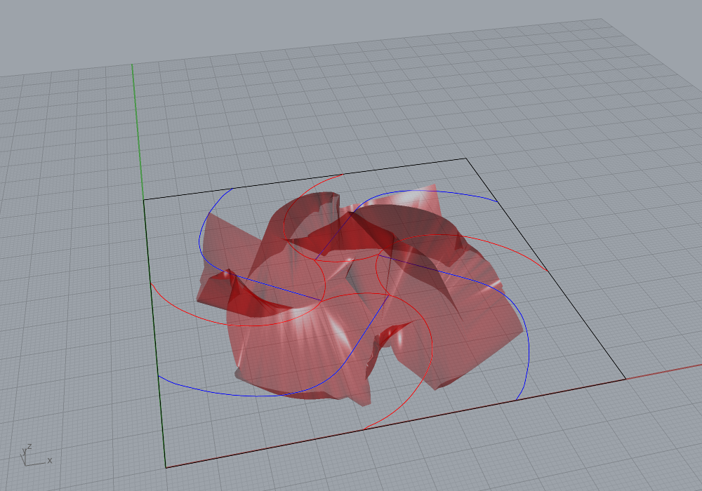
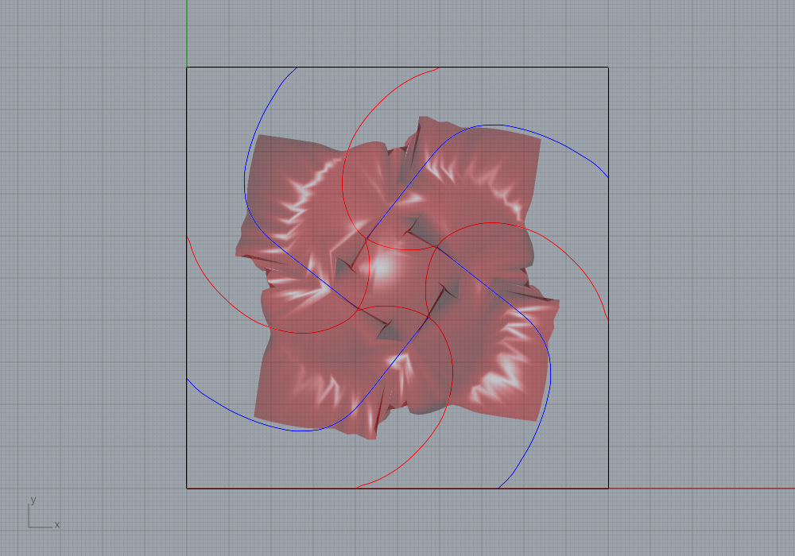
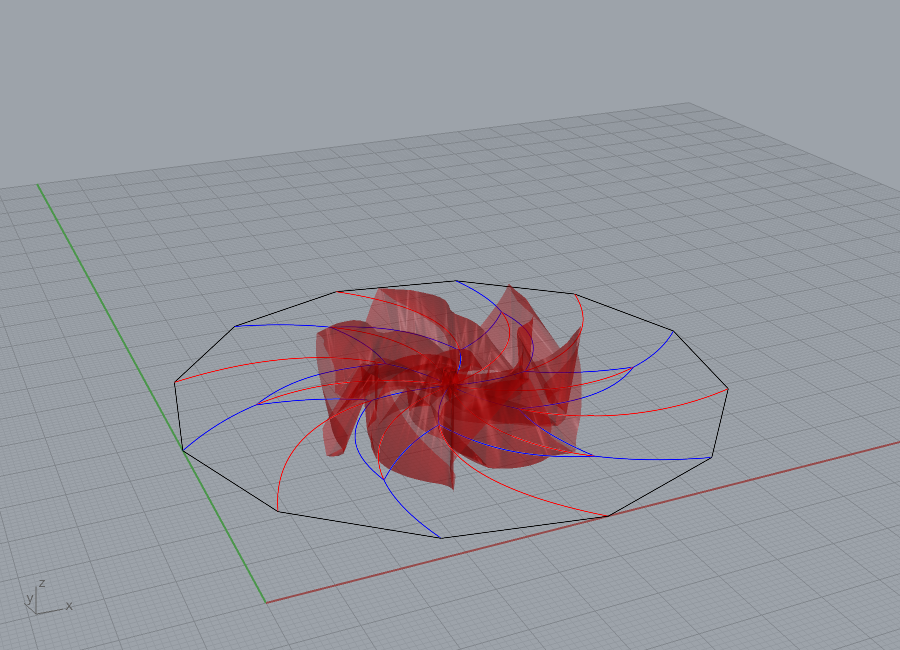
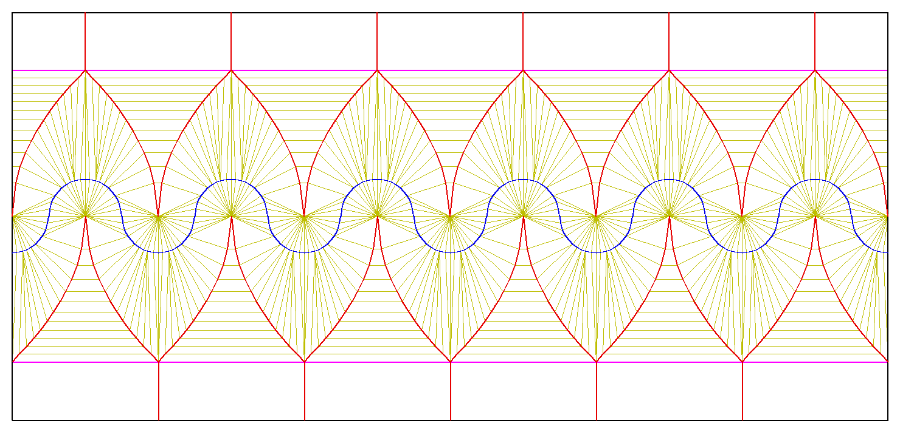
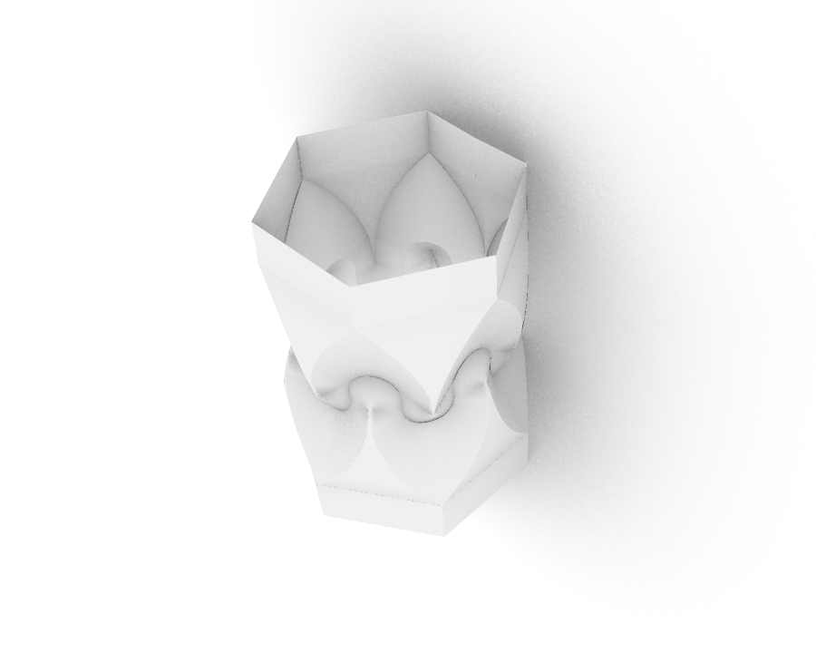
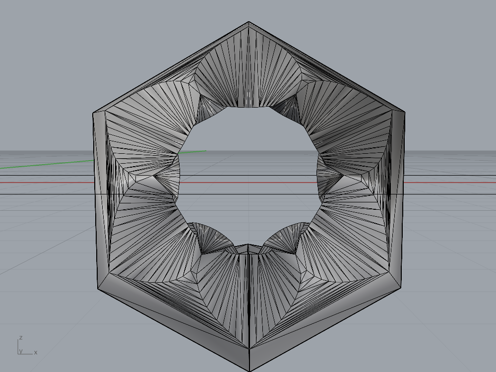
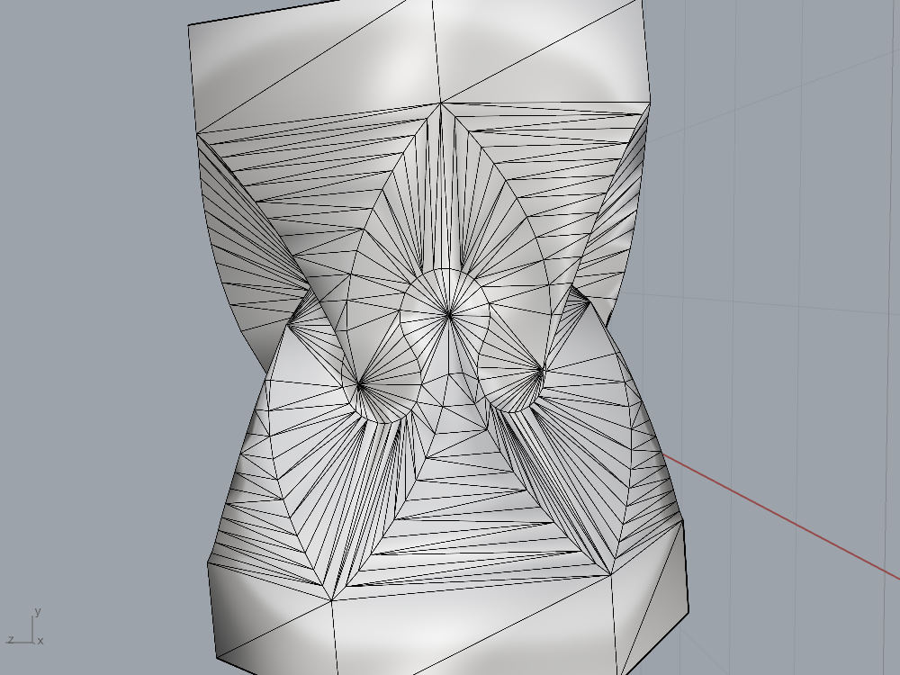

# Example crease patterns

`OrigamiExamples.3dm` holds 10 flat crease patterns from the original web app's [`assets/`](https://github.com/amandaghassaei/OrigamiSimulator/tree/7855983a613c879c171b2b1557f8cd102d2640cf/assets) folder, drawn as Rhino lines. Each pattern is scaled so its longest side is 100 units and laid out on a 5-column grid.

## Layers

Each crease type has its own layer. The colours match the web app's SVG convention ([`js/pattern.js`](https://github.com/amandaghassaei/OrigamiSimulator/blob/7855983a613c879c171b2b1557f8cd102d2640cf/js/pattern.js), `typeForStroke`).

| Layer | Colour | Solver input |
|---|---|---|
| Mountain | red | `M` |
| Valley | blue | `V` |
| Border | black | `B` |
| Facet | yellow | `F` (a flat crease held at 0° with the facet stiffness) |
| Cut | green | `C` (the sheet is split along it) |
| Hinge | magenta | `H` (an edge with no fold spring) |
| Labels | grey | none (ignored) |

These match the layer table in [`grasshopper/README.md`](../README.md#use-your-own-crease-pattern).

Each pattern is a Rhino group named after the pattern. Every line carries these User Text keys: `Pattern`, `CreaseType`, `TargetAngleDeg` and `Source`. `TargetAngleDeg` is 180 × the SVG stroke opacity. Both definitions read it, so partial-angle creases (for example in the crane) fold to their own angle at Fold = 1. The crane folds in both `OrigamiSim.gh` and `OrigamiSim_Kangaroo.gh` when Fold is ramped up gradually; see [Kangaroo version](../README.md#kangaroo-version).

## Patterns

| Pattern | Source | Notes |
|---|---|---|
| Simple Vertex | `SimpleFolds/simpleVertex.svg` | |
| Map Fold | `SimpleFolds/mapfold.svg` | |
| Waterbomb Base | `Bases/waterbombBase.svg` | partial-angle creases |
| Bird Base | `Bases/birdBase.svg` | partial-angle creases |
| Traditional Crane | `Origami/traditionalCrane.svg` | facet lines; creases at 45°, 90°, 135° and 180° |
| Square Twist | `Origami/singlesquaretwist.svg` | |
| Hypar | `Origami/hypar.svg` | 94 hinge lines |
| Miura-ori | `Tessellations/miura-ori.svg` | |
| Waterbomb Tessellation | `Tessellations/waterbomb.svg` | |
| Popup Simple | `Popup/popupSimple.svg` | cut lines (kirigami) |

## Curved creases: Flower and Rotating Star

Both files need the solver's curved-folding import: set **Vertex Interval** to 2, switch **Curved** on, lower **Facet Strength** (0.1–0.3) and ramp **Fold** slowly (0.05 per step, about 30 solves per step). See [Curved creases](../README.md#curved-creases) in the main README. With the controls off these patterns tangle, as they do in the web app's standard import.

### Flower

`Flower.3dm` is "Artwork 14: Flower" from Jun Mitani's *Curved-Folding Origami Design* (CRC Press, 2019): four partial cones laid out toward the centre, their curves joined into a whirl. Solid lines are mountains, dashed are valleys; every crease carries `TargetAngleDeg` = 150, because a curved crease cannot fold flat.

It was traced from the book's diagram (not included) by `flower_trace.py` (PIL + numpy: skeletonise the lines, average the four 90° rotations, write one sector to `flower.json`), and `build_flower_3dm.py` draws the four rotated copies as polylines on the Border, Mountain and Valley layers. The traced lines sit within 1 % of the sheet side of the book's drawing. In the artwork the four valley arcs end free inside the sheet; the builder's `EXTEND_VALLEYS` option (on) adds a straight valley line from each free end along the arc's tangent to the mountain arm (21.65 units), which is how the pattern was made to fold in the web app's curved importer (that importer cannot mesh a face with a free-ended crease). `EXTEND_KIND = "hinge"` draws the extension on the Hinge layer instead; it folds about the same.

Folded with Vertex Interval 2, Curved on, Facet Strength 0.1 and Fold ramped 0 → 1 in 20 steps of 30 solves: four lobes rise around the centre square, every one of the 296 mountain/valley creases bends the right way, strain 1.2 %, and the creases settle about 39° short of their 150° targets (mean crease error 38.7°, down from about 50° with the standard triangulation, where the sheet crumpled). The triangulation is a set of cones with rulings radiating from each lobe's apex (`captures/flower-curved-triangulation.png`). The fold stops short because the cones have to bend sharply near their apexes, not because of a tangle: at Facet Strength 1 the error is 60° and at 0.3 it is 50°, all with every crease on the right side.





### Rotating Star

`RotatingStar.3dm` is the web app's `assets/Curved/Rotating_Star.svg`: a 12-sided sheet with 12 mountain and 24 valley Bezier curves at full 180° targets. `svg_curves_to_polylines.py` flattens each cubic Bezier the way the web app's curved importer does (split at the midpoint until the chord is within 0.05 units of the curve and shorter than 2 units) and writes `rotating_star.json`; `build_polylines_3dm.py` draws the polylines. Folded with the same settings (Facet Strength 0.3) it turns into the rotating star: all 736 creases on the right side, mean crease error 26.5° against targets a curved crease cannot reach. With the standard triangulation it tangles (mean error 57°, nine creases folded the wrong way).



## Huffman Tower (Hexagonal Column with Cusps)

`HuffmanTower.3dm` is David Huffman's *Hexagonal Column with Cusps* (1978): a strip of six cells that closes into a hexagonal column with a swirl of cusps at the waist. The geometry follows Mundilova, Demaine, Lang and Tachi, [*Analysis of Huffman's Hexagonal Column with Cusps*](https://erikdemaine.org/papers/HuffmanColumn_OSME2024/) (Origami⁸, 2024): about each cusp a circle of radius 1 (valley), and from each cusp a parabola with its focus at the cusp, its vertex 2 units along the strip and its apex 4 units across on the cap fold line (mountain); the strip is 8 wide, a cell is 4 long, and the lower half of each cell is the upper half turned 180° about the point between two cusps. The curves are the same as in the web app's own `assets/Curved/huffmanTower.svg` (within 2 px at 72 px per unit), and so are the fold angles: every parabola and circle crease folds to 54° (the SVG's stroke opacity 0.3 × 180°) and the cap creases to 60°. The flat cap bands carry the hexagon's edges as 60° mountains, offset half a cell top to bottom; the cap fold lines are Hinge lines, and the two strip ends are on the `Seam` layer so the solver can close the tube (see [Seams](../README.md#seams)). The same model is Figure 2 of Demaine, Demaine and Koschitz's [*Reconstructing David Huffman's Legacy in Curved-Crease Origami*](https://erikdemaine.org/papers/Huffman_OSME2010/) and Figures 7 and 9 of [*Conic Crease Patterns with Reflecting Rule Lines*](https://arxiv.org/abs/1812.01167) (Origami⁷, 2018), which shows that the natural fan rulings cannot fold.



The same pattern is generated live by `HuffmanTower.gh` ([Huffman Tower definition](../README.md#huffman-tower-definition)); this file is for folding it in `OrigamiSim.gh` from layers. The pattern carries its rulings as Facet lines (olive above), so it is folded with **Vertex Interval** 0 and **Curved** off: lines along the strip in the concave regions between two arches (the 2024 paper's cylinders), fans from each cusp into its half-disc (cones), and in the region inside an arch the rulings of the paper's computed central patch, which join points of the parabola to points of the circle. [`huffman_tower.py`](huffman_tower.py) integrates the paper's equations (18)–(20) from its published initial values (s₂(0) = 0.6016, φ₁(0) = −0.7753, φ₂(0) = 0.6755) to place those rulings. Its default targets are the web app's 54° on every curved crease; its `paper` mode instead writes the fold angle 2φ of the same solution to every segment as `TargetAngleDeg` (91.7–96.8° on the parabolas, 60.8–93.8° on the circles), which is the physical model's geometry but folds the waist to 0.53 of the cap radius with crumpled rulings, where the web app's 54° gives 0.72 and Huffman's photograph about 0.64. The module is pure Python and is also what the generator component in `HuffmanTower.gh` runs ([Huffman Tower definition](../README.md#huffman-tower-definition)). [`huffman_tower_check.py`](huffman_tower_check.py) checks the construction: circle and parabola vertices exact to 1e-6, rulings ending on crease vertices with no crossings, no two vertices closer than 0.09 (the solver merges within about 0.066), both target modes giving the same vertices, and the curves within 2 px of the web app's own `assets/Curved/huffmanTower.svg` at 72 px per unit (that 2017 Illustrator drawing is itself 1.5 px off the analytic parabolas).

Folded with Facet Strength 1, Vertex Interval 0, Curved off and Fold ramped 0 → 1 in 20 steps of 30 solves: the tube closes between Fold 0.2 and 0.4 (seam gap 0.02 units at the end), all 515 mountain and valley creases bend the right way, strain 1.2 %, mean crease error 5°, max 13°. The parabolas settle at 48° (42–54°) and the circles at 51° (41–56°) against the 54° targets, the cap creases at 60°, so the caps are regular hexagons of side 4.0; the column keeps 99 % of its flat height and the waist radius is 0.67 of the cap radius. The web app's own model of this file (exported at 100 % and measured in Rhino) folds to 45° on both curves with a waist ratio of 0.72, and the same SVG through this solver gives 44° / 46° and 0.77, so the two simulators agree; the difference people see between them is only the mesh shading, which the solver now matches by splitting its mesh vertices along the creases ([Outputs](../README.md#outputs)). Without the seam the strip still closes through its 60° cap creases, only more slowly (1.8 units open after 1,000 solves at Fold 1).







## Using one with `OrigamiSim.gh`

Both definitions read the crease layers directly through Geometry Pipelines (`*Mountain`, `*Valley` and so on), so there is nothing to set by hand.

1. Open `OrigamiExamples.3dm` (or import it into your model) and open `OrigamiSim.gh`.
2. Hide every object that is not part of the pattern you want, for example select its group, invert the selection and run `Hide`. Pipelines ignore hidden objects, so only the visible pattern is simulated.

`OrigamiSim_Kangaroo.gh` reads the same layers, so the same steps work with it.

## Regenerating

The source SVGs are not in this repo. Download the ones you need from the original [`assets/`](https://github.com/amandaghassaei/OrigamiSimulator/tree/7855983a613c879c171b2b1557f8cd102d2640cf/assets) folder (for example `https://raw.githubusercontent.com/amandaghassaei/OrigamiSimulator/7855983a613c879c171b2b1557f8cd102d2640cf/assets/Origami/traditionalCrane.svg`), then run:

```bash
python grasshopper/examples/svg_to_segments.py grasshopper/examples/patterns.json "Name=path/to/pattern.svg" ...
```

Then run `build_examples_3dm.py` inside Rhino 8 with the ScriptEditor. Change `PICK` in that script to choose the patterns. The parser handles `line`, `path` (M/L/H/V/Z only), `polyline`, `polygon` and `rect`, along with group stroke inheritance and transforms. If a pattern uses curves (for example the upstream `assets/Curved` files), the parser raises an error; use `svg_curves_to_polylines.py` for those:

```bash
python grasshopper/examples/svg_curves_to_polylines.py grasshopper/examples/rotating_star.json "Rotating Star=path/to/Rotating_Star.svg"
```

Then run `build_polylines_3dm.py` inside Rhino 8 with `JSON_PATH` set to that file.

`HuffmanTower.3dm` needs no SVG: run `build_huffman_tower_3dm.py` inside Rhino 8 (it imports `huffman_tower.py` from its own folder; define `CELLS_OVERRIDE`, `CAP_OVERRIDE`, `TARGETS_OVERRIDE`, `SEAM_OVERRIDE` and so on before exec-ing it to change the parameters). `python3 huffman_tower_check.py [--svg huffmanTower.svg] [--png out.png]` checks the pattern and draws it. Curves become polylines, which the solver treats as curved creases (a plain Line is not one), so draw curved creases as polylines or curves, never as chains of separate lines.
